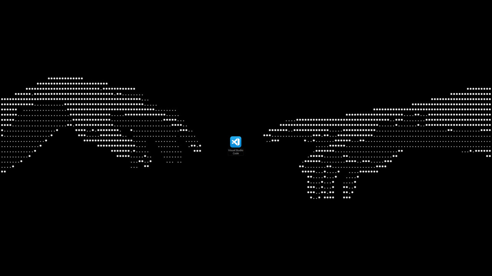

  

<h1 align="center">I use arch, btw</h1>

Hi, im w1n4a. My love is Rust & Linux, but i can coding in another language (python,gd,lua, html+css...)

---

<h1 align="center">
  My best works:
</h1>

<ul align="center">
  <li><a href="https://github.com/w1n4a/befli">Befli</a> - simple args system for Rust (package)</li>
  <li><a href="https://github.com/w1n4a/equ">Equ</a> - simple data system for Rust (package)</li>
  <li><a href="https://github.com/w1n4a/CTkPlus">Equ</a> - simple data system for Rust (package)</li> #Sorry for readme looks ai-slop
</ul>
